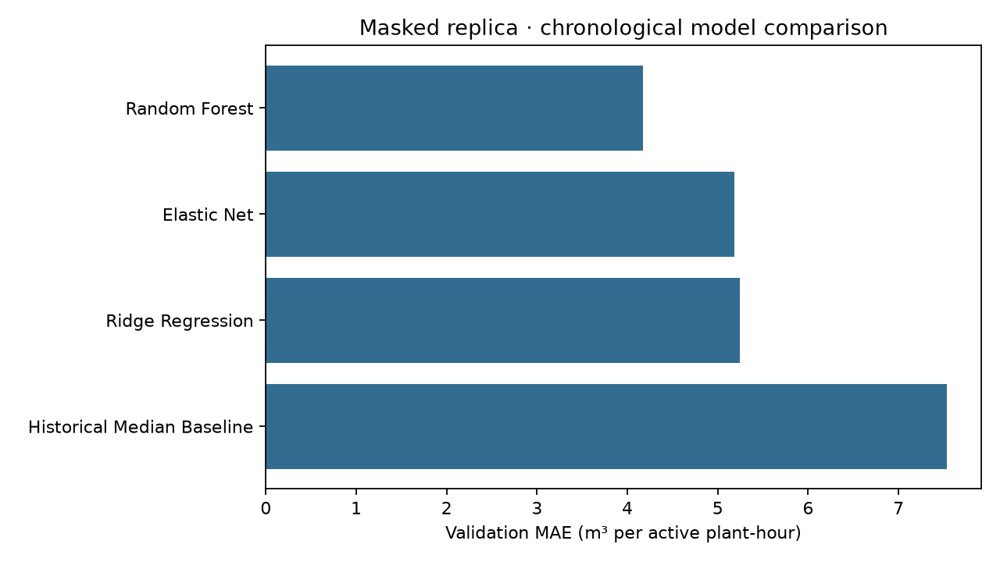
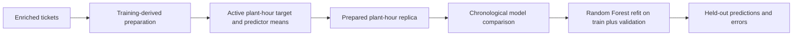

# Ready-Mix Demand Forecasting

How much concrete is needed for each active plant-hour once schedule context is available?

**Random Forest reaches a replica test MAE of 4.081 m³ per active plant-hour.**
Its replica validation MAE is 4.169 m³, compared with 7.538 m³ for the historical-median baseline.


[](LICENSE)



Built on a company's real operating data. Under a confidentiality agreement, the numbers shown come from a masked replica that keeps the data's shape, not its values.

## How it works

The target sums delivered volume by plant, date, and assignment hour. Ticket
predictors are averaged for that key; ticket volume and its direct summaries are
excluded from inputs. The runnable experiment starts from the prepared replica,
with training, validation, and test periods in chronological order.



The package includes numeric preparation and ticket aggregation utilities.
The CLI begins at the prepared plant-hour table. It compares a global median,
Ridge, Elastic Net, and Random Forest, then retrains the chosen forest in memory.

## Replica results

All errors are per active plant-hour. MAE and RMSE use m³; sMAPE uses percent.
Cross-validation shows MAE mean ± sample standard deviation across expanding
chronological folds. Only the selected model receives a final held-out score.

| Model | Validation MAE | Validation RMSE | Validation sMAPE | CV MAE |
| --- | ---: | ---: | ---: | ---: |
| Random Forest | 4.169 | 7.736 | 39.59% | 4.108 ± 0.194 |
| Elastic Net | 5.187 | 8.307 | 63.90% | 4.913 ± 0.102 |
| Ridge | 5.245 | 8.291 | 64.51% | 4.943 ± 0.112 |
| Historical median | 7.538 | 13.589 | 73.01% | 7.105 ± 0.158 |

| Selected Random Forest test | MAE | RMSE | sMAPE |
| --- | ---: | ---: | ---: |
| Masked replica | 4.081 | 7.050 | 38.51% |

The complete values, model parameters, split boundaries, and fold errors are in
[replica_metrics.json](results/replica_metrics.json). Predictions are saved in
[test_predictions.csv](results/test_predictions.csv).

## Quickstart

Use Python 3.14.

```bash
git clone https://github.com/diegomadriz/ready-mix-demand-forecasting.git
cd ready-mix-demand-forecasting
python3.14 -m venv .venv
source .venv/bin/activate
python -m pip install '.[dev]'
ruff check .
ruff format --check .
pytest -q
ready-mix --output out
```

`ready-mix` retrains the comparison and writes the table, figure, metrics, and
test predictions into the output folder (`results/` by default, which holds the
saved run). To use another prepared table:

```bash
ready-mix --data data/plant_hour.csv --output out
```

## Layout

```text
src/ready_mix/    Preparation, model comparison, pipeline, and CLI
data/            Prepared masked plant-hour replica
results/         Recomputed replica metrics, predictions, table, and figure
tests/           Behavioral tests and saved-prediction metric checks
docs/            Model decisions, differences, and fidelity limits
.github/         CI on Python 3.12 and 3.14
```

## Limitations

Evaluation covers observed active hours and excludes zero-demand hours. Some
predictors depend on schedule and route context available near the scheduling
decision; these results do not establish earlier forecasting performance.
Enrichment is incomplete, tuning is limited, and preprocessing is shared across
cross-validation folds. Row-based folds can divide a date.

The replica preserves the real model's ranking and keeps held-out MAE and sMAPE
within 30% of the real model. Individual predictions, per-plant error, RMSE agreement, uncertainty
calibration, operational gains, and re-identification resistance were not
established. The raw-data joins cannot be reproduced from this prepared table.
The replica uses its own feature representation and calendar. See the
[model decisions](docs/model-decisions.md) for the exact differences.

## Modeling scope

This repository contains the data-preparation and modeling pipeline from a student
team project: the plant-hour target, chronological evaluation, baseline comparison
and the final Random Forest. The team's application (inference service, dashboards,
client-demand model and deployment) was built by other team members and is not
part of this public repository.

[Portfolio walkthrough](https://www.diegoramirezmadriz.dev/projects/ready-mix-demand-forecasting)
· [Model report](docs/model-decisions.md)
